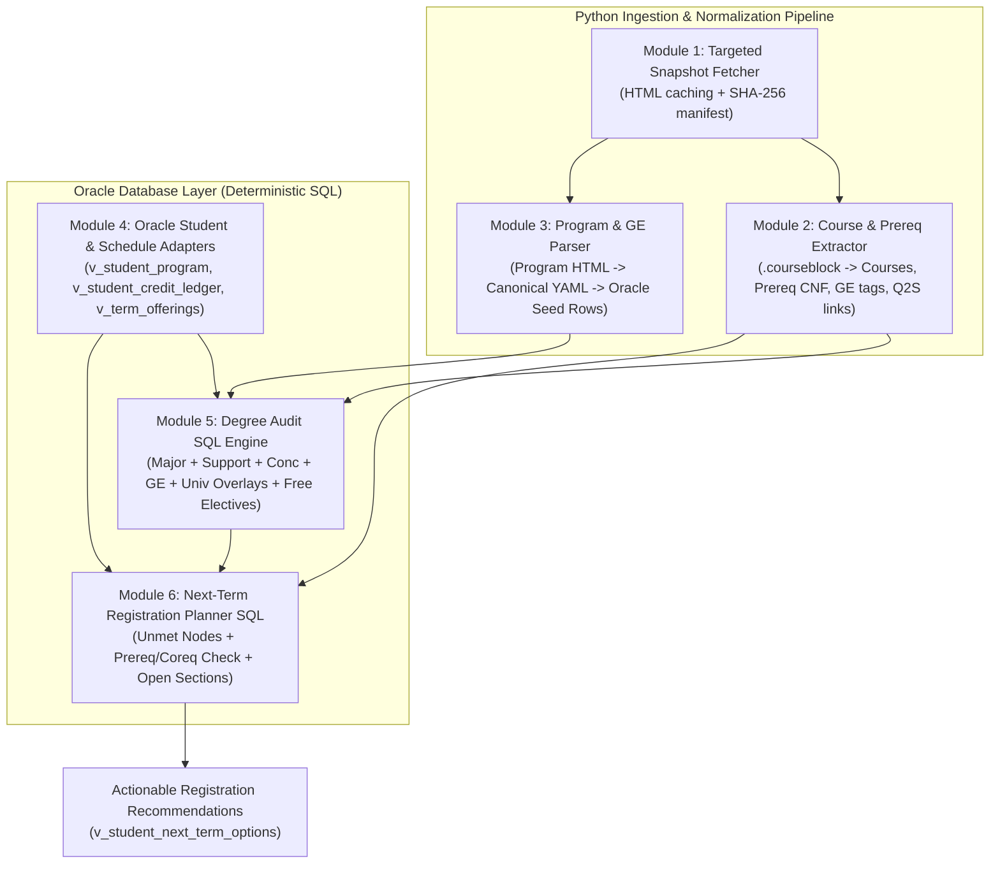

# Specification & Modular Implementation Plan: Cal Poly Degree Audit & Term Registration System

## 1. Objective & Design Principles

### 1.1 System Goal
Deterministically evaluate every active Cal Poly student's academic record (courses completed, courses in progress, AP/IB/test credit, and transfer credit) against their assigned catalog's **full degree requirements** (Major, Support, Concentration, General Education, and University-wide graduation requirements) **in Oracle SQL**, and join unmet requirements with course prerequisites/corequisites and upcoming term offerings to recommend valid courses for registration.

### 1.2 Core Engineering Principles
1. **Thin Vertical Slice First (Minimum Work per Step):** Never bulk-scrape all programs or catalogs upfront. Prove every component end-to-end on **one program in one catalog (`B.S. Mathematics`, `2022-2026` catalog)** first, then add remaining active Mathematics catalogs, then expand one program at a time.
2. **Strict Component Contracts:** Six modular stages communicate solely through normalized tables/views so scraping changes never break audit SQL and PeopleSoft/Oracle table quirks stay isolated in an adapter layer.
3. **Catalog-First Prerequisite & Q2S Discovery:** Extract prerequisites, corequisites, GE mappings, and `"Formerly ..."` Quarter-to-Semester (Q2S) equivalencies directly from the online catalog HTML first, before investigating internal Oracle requirement-group tables.

---

## 2. Ground-Truth Findings from the Live Cal Poly Catalog

An inspection of `catalog.calpoly.edu` (current `2026-2028` semester catalog) and `previouscatalogs.calpoly.edu` revealed four structural facts that shape this specification:

1. **Catalog Edition Mapping (`2022-2026` Covers `2023-2025` Cohorts):**
   * Cal Poly extended the 2022 quarter catalog through Spring 2026 as the **`2022-2026`** catalog (`/previouscatalogs/2022-2026/`), followed by the **`2026-2028`** semester catalog (`/`).
   * Modeling `2022-2026` B.S. Mathematics immediately covers **four entering cohorts (2022, 2023, 2024, and 2025)**.
2. **Rich Structured Metadata in `.courseblock` HTML (`/courses/<subject>/`):**
   Every course in the `2026-2028` catalog exposes dedicated CSS selectors:
   * `span.courseblockcode`, `span.courseblock__title`, `span.courseblock__hours` — e.g., `MATH 3152`, `Advanced Linear Algebra`, `(4 units)`.
   * `span.detail-typically_offered` — e.g., `F, SP, SU` (useful when future term schedules are not yet published).
   * `span.detail-gradebasis` — e.g., `CR/NC` (critical because Major/Support/Concentration courses prohibit `CR/NC`).
   * `span.detail-gearea` — **Dual-catalog GE tags in one field**, e.g.:
     `2026-28 or later catalog: GE Area 2` and `2020-26 catalogs: GE Area B4`.
   * `span.detail-prereq` — **Both 3-digit quarter and 4-digit semester prerequisites & concurrent/corequisites** with `<a class="bubblelink code">` tags, e.g.:
     * `MATH 3152`: *"Prerequisite: One of the following: MATH 206, MATH 244, MATH 1151, or MATH 2341; and MATH 248 or MATH 2031 with a grade of C- or better."*
     * `MATH 1262` (Calculus II): *"Prerequisite: MATH 141B with a grade of C- or better, MATH 142 with a grade of C- or better, or MATH 1261 with a grade of C- or better, or consent of instructor."*
   * `div.courseblock__description` — Explicit Q2S lineage and credit-exclusion clauses:
     * `"Formerly MATH 306."`, `"Crosslisted as HNRS/MATH 1261."`
     * `"Formerly offered as part of the MATH 141, 142, 143 series, students may not earn credit for both MATH 141 and MATH 1261."`
     * `"Not for baccalaureate credit."` (e.g., `MATH 900`).
3. **Nested Choice Trees in B.S. Mathematics (`2022-2026`):**
   * **Core Senior Project:** `MATH 459` OR `MATH 460` OR (`MATH 461` AND `MATH 462`).
   * **Applied Math Concentration Tracks:** Choose `Track A` (12 units from pool) OR `Track B` (`DATA 301` + `DATA 401 & 403` + 1 of `MATH 335/435/453`).
   * **Approved Electives Categories:** Choose 3 courses (12 units) *within a single category* (Physics, CS, etc.), with *at least 1 course at the 300–400 level*.
4. **GE & University Graduation Overlays on `2022-2026` B.S. Mathematics:**
   * **Major/GE Double-Counting:** `MATH 141` (`B4`), `MATH 142` (`GE Electives`), `MATH 334` (`UD-B`), and `PHYS 142/143` (`B1 & B3`) satisfy both Major and GE, while their units count **once** toward the 180-unit total (adjusting Free Electives automatically).
   * **Prefix/Area Diversity Rules:** GE Area C Lower-Division requires **3 distinct prefixes**; GE Area D requires **2 distinct prefixes**; GE Electives requires **2 distinct GE areas**.
   * **Graduation Minimums:** `>= 60` quarter upper-division units (`300-400` / `3000-4000`), `C-` minimum in Golden Four (`A1`, `A2`, `A3`, `B4`), `USCP`, `GWR`, `>= 2.0` GPA, and `180` total baccalaureate quarter-equivalent units.

---

## 3. Modular System Architecture



---

## 4. Component Data Contracts (Oracle SQL Dialect)

> **Oracle Conventions Used:** `VARCHAR2`, `NUMBER`, `CHAR(1)` (`'Y'`/`'N'` for universal compatibility across Oracle 19c/23ai), `WITH` subquery factoring, `ROW_NUMBER() OVER (...)`, and `LISTAGG(... WITHIN GROUP (...))`.

### 4.1 Module 1: Targeted Snapshot Fetcher (`src/ingest/`)
* **Input:** Explicit list of target URLs (starting with just `2022-2026` B.S. Mathematics + its 4 concentration subpages + `2022-2026` GE catalog list + `2026-2028` `/courses/` pages for referenced prefixes).
* **Output:** Immutable raw HTML files under `snapshots/<catalog>/...` + `snapshots/manifest.json` (`snapshot_id`, `url`, `fetched_at`, `sha256`).

---

### 4.2 Module 2: Course Catalog, Q2S Equivalency & Prerequisite Schema (`src/courses/` -> Oracle `CAT_*` Tables)

```sql
-- Canonical catalog of both historical 3-digit quarter and current 4-digit semester courses
CREATE TABLE cat_courses (
    offering_course_key    VARCHAR2(32)  PRIMARY KEY, -- e.g. 'Q:MATH_141' or 'S:MATH_1261'
    course_id              VARCHAR2(20),              -- Institutional CRSE_ID (populated from Oracle or Q2S link)
    subject_code           VARCHAR2(10)  NOT NULL,    -- 'MATH'
    course_number          VARCHAR2(10)  NOT NULL,    -- '141' or '1261'
    title                  VARCHAR2(200) NOT NULL,
    term_system            VARCHAR2(10)  NOT NULL,    -- 'QUARTER' or 'SEMESTER'
    min_units              NUMBER(4,2)   NOT NULL,
    max_units              NUMBER(4,2)   NOT NULL,
    course_level           NUMBER(1)     NOT NULL,    -- Normalized 0 (remedial), 1, 2, 3 (UD), 4 (UD)
    is_baccalaureate       CHAR(1)       DEFAULT 'Y' NOT NULL, -- 'N' for MATH 900 ("Not for baccalaureate credit")
    cr_nc_only             CHAR(1)       DEFAULT 'N' NOT NULL,
    typically_offered      VARCHAR2(30),              -- e.g. 'F, SP, SU'
    ge_area_2020_2026      VARCHAR2(30),              -- e.g. 'B4', 'B1,B3', 'C1'
    ge_area_2026_plus      VARCHAR2(30),              -- e.g. '2', '5A,5C'
    is_uscp                CHAR(1)       DEFAULT 'N' NOT NULL,
    is_gwr_eligible        CHAR(1)       DEFAULT 'N' NOT NULL
);

-- Cross-listings, "Formerly MATH xxx" links, mutual credit exclusions, and split-series Q2S bridges
CREATE TABLE cat_course_equivalencies (
    equiv_id               VARCHAR2(64)  PRIMARY KEY,
    equiv_type             VARCHAR2(20)  NOT NULL,    -- 'FORMERLY_1_TO_1', 'CROSSLIST', 'CREDIT_EXCLUSION', 'SERIES_BRIDGE'
    prior_course_set       VARCHAR2(200) NOT NULL,    -- e.g. 'Q:MATH_248' or 'Q:MATH_141+Q:MATH_142'
    semester_course_set    VARCHAR2(200) NOT NULL,    -- e.g. 'S:MATH_2031' or 'S:MATH_1262'
    notes                  VARCHAR2(400)
);

-- Conjunctive Normal Form (CNF: AND of OR-groups) for Prerequisites & Corequisites
-- Example: MATH 3152 requires Group 1 (MATH 206 OR MATH 244 OR MATH 1151 OR MATH 2341)
--                         AND Group 2 (MATH 248 [C-] OR MATH 2031 [C-])
CREATE TABLE cat_course_prereq_options (
    offering_course_key    VARCHAR2(32)  NOT NULL REFERENCES cat_courses(offering_course_key),
    and_group_num          NUMBER(3)     NOT NULL,    -- Every distinct and_group_num must be satisfied
    option_num             NUMBER(3)     NOT NULL,    -- At least ONE option_num within an and_group_num must hold
    req_relation_type      VARCHAR2(16)  NOT NULL,    -- 'PREREQ', 'CONCURRENT', 'COREQ_OR_PREREQ', 'NON_COURSE'
    prereq_course_key      VARCHAR2(32),              -- e.g. 'Q:MATH_248' or 'S:MATH_2031' (NULL if NON_COURSE)
    non_course_code        VARCHAR2(40),              -- e.g. 'MATH_PLACEMENT', 'INSTRUCTOR_CONSENT', 'JR_STANDING'
    min_grade              VARCHAR2(4)   DEFAULT 'D-',-- e.g. 'C-' when explicitly stated
    raw_clause_text        VARCHAR2(500),
    PRIMARY KEY (offering_course_key, and_group_num, option_num)
);
```

---

### 4.3 Module 3: Program, Concentration, GE & Graduation Requirement Schema (`src/parser/` -> Oracle `REQ_*` Tables)

Every program catalog (`MATH_BS__2022_2026`) is represented as a single tree of `req_nodes` spanning **4 top-level domains**:
1. `MAJOR_CORE` & `SUPPORT` (exclusive pool `'MAJOR_PROGRAM'`)
2. `CONCENTRATION` (`GENERAL`, `APPLIED`, `PURE`, `TEACHING` — shares exclusive pool `'MAJOR_PROGRAM'`)
3. `GENERAL_EDUCATION` (`A1..F`, `UD-B`, `UD-C`, `UD-D`, `GE_ELECTIVES` — separate exclusive pool `'GE_PROGRAM'`, allowing double-counting with `'MAJOR_PROGRAM'`)
4. `UNIV_GRADUATION` (non-exclusive overlay checks: `TOTAL_180_UNITS`, `UD_60_UNITS`, `USCP`, `GWR`, `GPA_2_0`)

```sql
CREATE TABLE req_programs (
    program_version_id     VARCHAR2(64)  PRIMARY KEY, -- 'MATH_BS__2022_2026'
    program_code           VARCHAR2(32)  NOT NULL,    -- 'MATH_BS'
    catalog_code           VARCHAR2(16)  NOT NULL,    -- '2022-2026'
    catalog_unit_basis     VARCHAR2(10)  NOT NULL,    -- 'QUARTER' (180) or 'SEMESTER' (120)
    total_units_required   NUMBER(5,2)   NOT NULL,    -- 180.00
    min_ud_units_required  NUMBER(5,2)   NOT NULL     -- 60.00
);

CREATE TABLE req_nodes (
    node_id                VARCHAR2(100) PRIMARY KEY, -- e.g. 'MATH_BS_22_26.APPLIED.APPROVED_ELEC.PHYS'
    program_version_id     VARCHAR2(64)  NOT NULL REFERENCES req_programs(program_version_id),
    parent_node_id         VARCHAR2(100) REFERENCES req_nodes(node_id),
    domain_type            VARCHAR2(20)  NOT NULL,    -- 'MAJOR', 'SUPPORT', 'CONCENTRATION', 'GE', 'UNIV_OVERLAY'
    concentration_code     VARCHAR2(32),              -- NULL = all students; else 'GENERAL','APPLIED','PURE','TEACHING'
    label                  VARCHAR2(200) NOT NULL,
    rule_type              VARCHAR2(24)  NOT NULL,    -- 'ALL_OF', 'K_OF_NODES', 'COURSE_POOL', 'MILESTONE', 'UNIT_TOTAL'
    required_count         NUMBER(3),                 -- e.g. k=1 for Track choice, k=3 for 3-course category
    required_units         NUMBER(5,2),               -- in catalog_unit_basis (e.g. 12.00 quarter units)
    min_ud_courses         NUMBER(3)     DEFAULT 0,   -- e.g. 1 ("at least one course at 300-level or above")
    min_ud_units           NUMBER(5,2)   DEFAULT 0,
    min_distinct_prefixes  NUMBER(2)     DEFAULT 0,   -- e.g. 3 for GE Area C LD, 2 for GE Area D
    min_distinct_ge_areas  NUMBER(2)     DEFAULT 0,   -- e.g. 2 for GE Electives (Areas B, C, D)
    min_grade              VARCHAR2(4)   DEFAULT 'D-',-- 'C-' for Golden Four (A1, A2, A3, B4)
    allow_cr_nc            CHAR(1)       DEFAULT 'N', -- 'N' for Major/Support/Conc; 'Y' where allowed
    exclusive_pool_group   VARCHAR2(32),              -- 'MAJOR_PROGRAM' vs 'GE_PROGRAM' vs NULL (overlay)
    allocation_priority    NUMBER(4)     NOT NULL,    -- 10=Fixed Core, 20=Small Choice, 30=Conc Core, 40=Pool, 90=Elective
    display_order          NUMBER(4)     NOT NULL
);

CREATE TABLE req_node_courses (
    node_id                VARCHAR2(100) NOT NULL REFERENCES req_nodes(node_id),
    course_match_type      VARCHAR2(20)  NOT NULL,    -- 'EXACT_COURSE', 'PREFIX_RANGE', 'GE_AREA_TAG', 'USCP_TAG'
    offering_course_key    VARCHAR2(32),              -- e.g. 'Q:MATH_141' (matches S:MATH_1261 via course_id / equiv)
    subject_code           VARCHAR2(10),              -- used when course_match_type = 'PREFIX_RANGE'
    min_course_level       NUMBER(1),                 -- e.g. 3 for 300-400 / 3000-4000 level
    max_course_level       NUMBER(1),
    ge_area_tag            VARCHAR2(16),              -- e.g. 'C1', 'D2'
    is_excluded            CHAR(1)       DEFAULT 'N' NOT NULL
);
```

---

### 4.4 Module 4: Oracle Student & Term Offering Adapter Views (`sql/02_student_adapters.sql`)

Isolates PeopleSoft/Oracle tables behind four read-only views:

1. **`v_student_program_context`**
   * Maps Oracle student plan/subplan & requirement term (`REQ_TERM`) to `(student_id, program_code, catalog_code, concentration_code)` — defaulting undeclared concentration to `'GENERAL'`, with a deterministic fallback rule deriving `catalog_code` from matriculation/enrollment terms if `REQ_TERM` is absent.
2. **`v_student_credit_ledger`**
   * Unions completed Cal Poly courses, current `IN_PROGRESS` enrollments, articulated AP/IB test credits, and transfer coursework into one normalized row per credit attempt:
   * Key columns: `student_id`, `credit_event_id`, `source_type` (`'COURSE'`, `'AP'`, `'IB'`, `'TRANSFER'`), `course_id`, `offering_course_key`, `subject_code`, `course_level`, `term_code`, `term_system`, `attempt_status` (`'COMPLETED'`, `'IN_PROGRESS'`), `grading_basis` (`'GRD'`, `'CR'`), `grade`, `grade_rank`, `raw_units`, `quarter_equiv_units` (`CASE WHEN term_system = 'SEMESTER' THEN raw_units * 1.5 ELSE raw_units END`), `semester_equiv_units` (`CASE WHEN term_system = 'QUARTER' THEN raw_units * (2/3) ELSE raw_units END`), `ge_area_2020_2026`, `ge_area_2026_plus`, `is_uscp`, `is_repeat_superseded`.
3. **`v_student_milestones`**
   * `(student_id, milestone_code, status, numeric_value)` — `GWR`, `CUM_GPA`, `MAJOR_GPA`, `MATH_PLACEMENT`.
4. **`v_upcoming_term_offerings`**
   * `(term_code, offering_course_key, course_id, section_count, open_seats_total, waitlist_total, schedule_summary)`.

---

### 4.5 Module 5: Deterministic Oracle SQL Degree Audit Engine (`sql/03_degree_audit.sql`)

Evaluates any student's full degree in **five deterministic CTE stages**:

1. **`cte_eligible_matches`:** Joins `v_student_credit_ledger` (`is_repeat_superseded = 'N'`) to leaf `req_nodes` via `course_id`, `cat_course_equivalencies`, `PREFIX_RANGE`, or `GE_AREA_TAG`, enforcing `min_grade`, `allow_cr_nc`, and `is_excluded = 'N'`.
2. **`cte_deterministic_allocation`:** Within each `(student_id, exclusive_pool_group)`, assigns each `credit_event_id` by `(allocation_priority ASC, display_order ASC)` so:
   * A course cannot be double-counted inside `'MAJOR_PROGRAM'` (e.g., `MATH 416` won't count for both Applied Math Core and Track A).
   * The *same* `credit_event_id` **can** simultaneously allocate to `'GE_PROGRAM'` (e.g., `MATH 141` satisfies both Major Core and GE `B4`) and `'UNIV_OVERLAY'` (`UD_60_UNITS`, `USCP`).
3. **`cte_leaf_evaluation`:** Computes `units_completed`, `units_in_progress`, distinct prefix count (`COUNT(DISTINCT subject_code)`), upper-division count/units, and node status (`'MET'`, `'IN_PROGRESS'`, `'PARTIAL'`, `'NOT_STARTED'`), plus `LISTAGG` audit trail of satisfying courses.
4. **`cte_branch_rollup`:** Evaluates parent `ALL_OF` and `K_OF_NODES` (such as choosing the best-progressed Concentration Track or Approved Elective Category, or matching `MATH 461 + 462`).
5. **`cte_degree_unit_summary` (Automatic Free Electives):** Sums `quarter_equiv_units` (or `semester_equiv_units`) across **distinct** baccalaureate `credit_event_id`s to compute exact remaining units needed to reach `180` (or `120`), eliminating manual Free Elective unit adjustments when Major and GE overlap.

---

### 4.6 Module 6: Next-Term Registration Planner SQL (`sql/04_term_planner.sql`)

Joins unmet/partial nodes from `03_degree_audit.sql` with `cat_courses` (`term_system = 'SEMESTER'`), `cat_course_prereq_options`, and `v_upcoming_term_offerings`:

* **Credit-Exclusion Filter:** Excludes any semester course blocked by `CREDIT_EXCLUSION` against already-completed quarter courses (e.g., blocks `MATH 1261` if student already passed `MATH 141`).
* **Prerequisite & Corequisite Evaluation:** Evaluates every `and_group_num` of `cat_course_prereq_options` against the student's `COMPLETED` + `IN_PROGRESS` ledger:
  * `'ELIGIBLE_NOW'` — all `and_group_num` satisfied by `COMPLETED` credits/milestones.
  * `'ELIGIBLE_PROVISIONAL'` — satisfied once current `IN_PROGRESS` enrollments finish this term.
  * `'ELIGIBLE_WITH_CONCURRENT'` — requires co-enrolling in a `CONCURRENT` course offered in the same term.
  * `'NEEDS_PLACEMENT_OR_CONSENT'` — all course prereqs met, non-course check (`MATH_PLACEMENT` / `INSTRUCTOR_CONSENT`) flagged.
  * `'BLOCKED_PREREQ'` — lists missing prerequisite group(s).
* **Multi-Impact Scoring:** Flags courses that satisfy **multiple unmet requirements at once** (e.g., an unmet GE Area + `USCP` + Upper-Division units, or Support + GE `B1/B3`) and counts **downstream required courses unlocked**.

---

## 5. Phased Implementation Plan (Minimum Work at Every Step)

### Phase 0: Local Vertical Prototype & Catalog Prereq Inspection (`B.S. Math`, `2022-2026`)
* **Goal:** Inspect real extracted catalog prerequisites/coreqs/Q2S links and prove all SQL logic end-to-end before touching Oracle tables.
* **Step 0.1 — Targeted Course Block Extraction:** Fetch & parse **only** the `2026-2028` course pages referenced by B.S. Math (`MATH`, `STAT`, `DATA`, `CSC`, `CPE`, `PHYS`, `ASTR`, plus sample GE courses). Export a clean report of extracted prerequisites, corequisites, GE dual-tags, and `"Formerly"` Q2S mappings so you can review exactly what the catalog gives us vs. what might need Oracle tables.
* **Step 0.2 — Parse `2022-2026` B.S. Mathematics + GE:** Fetch & parse the `2022-2026` B.S. Mathematics page, its 4 concentration pages, and the `2022-2026` GE structure into canonical YAML + SQL seed scripts.
* **Step 0.3 — Build & Test Audit + Planner SQL on Synthetic Students:** Author `01_schema.sql`, `03_degree_audit.sql`, and `04_term_planner.sql` in Oracle-compatible SQL, accompanied by a standalone test harness (both local SQLite/DuckDB for instant CLI assertions **and** a zero-table `WITH ... FROM DUAL` Oracle test script you can run read-only in Oracle SQL Developer) across 5 synthetic students (Q2S mid-Calculus transition, AP/transfer credits, Applied Math Track/Category choices, GE prefix diversity, Senior in-progress).
* **Exit Gate:** You inspect the extracted prereq report and the 5 synthetic student registration plans and confirm the schema and outputs match advisor expectations.

### Phase 1: Connect Oracle Adapter Views for `2022-2026` Mathematics Students
* **Goal:** Run the validated SQL audit and next-term planner against real `2022-2026` Mathematics majors in Oracle.
* **Work Items:**
  1. Write `02_student_adapters.sql` mapping your Oracle transcript, enrollment, test-credit, and class-offering tables into the 4 adapter views.
  2. Decide (based on Step 0.1 findings) whether any non-course prerequisite checks (like Math Placement) need an extra column from Oracle.
  3. Spot-check ~15–20 real `2022-2026` Math students across all 4 concentrations against official DPRs and refine any edge-case Q2S bridge rules.

### Phase 2: All Remaining Active Catalogs for B.S. Mathematics
* **Goal:** Cover 100% of currently enrolled Mathematics students.
* **Work Items:**
  1. Query Oracle for distinct active catalogs among Math majors (`SELECT catalog_code, COUNT(*) ...`) — likely adding `2026-2028` (semester native, 120 units + new GE Areas 1–6) and any 5th/6th-year students on `2021-2022` or `2020-2021`.
  2. Fetch & parse only those active Math catalog editions + the `2026-2028` GE template.
  3. Run full-cohort audit & registration verification for Mathematics.

### Phase 3: Program-by-Program Onboarding
* **Goal:** Expand one major at a time (e.g., Statistics -> Data Science -> Computer Science -> Physics -> remaining colleges), driven by active student headcount.
* **Work Items:**
  1. Fetch only active catalog pages + newly referenced `/courses/<subject>/` pages for the next major.
  2. Add regression tests whenever a major introduces a new catalog rule nuance, keeping all previously validated majors passing.

### Phase 4: Automated Term Refresh & Advising Output Delivery
* **Goal:** Scheduled refresh of upcoming term section availability and student registration recommendations ahead of each registration window.

